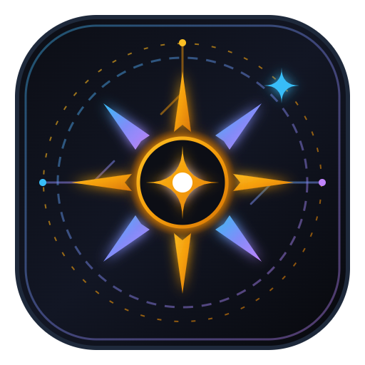

# R3 AI Studio 🌟
**Intelligent AI Workstation & Local Media Studio | محطة الذكاء الاصطناعي واستوديو الوسائط**

<p align="center">
  
  <br>
  <strong>R3 - Next-Generation Desktop AI Workstation</strong>
  <br>
  <em>Powered by Google Gemini 3.5, ChatGPT 4o, Liquid Glass UI, Voice I/O & High-Resolution PDF Engine</em>
</p>

<p align="center">
  
  
  
  
  
  
  
</p>

---

## 📖 English Overview
**R3 AI Studio** is a unified, high-performance desktop workstation designed for rapid AI development, document intelligence, media management, and software productivity. Built with React 19, Tailwind CSS, and a Python FastAPI backend, R3 provides seamless switching between Google Gemini and OpenAI ChatGPT models, direct high-resolution PDF generation, continuous background media playback, live voice input/output, and a curated repository of 100+ global web tools.

### ✨ Key Features
- **🤖 Dual AI Engine:** Seamlessly chat and switch between **Google Gemini 3.5 Flash** (free & ultra-fast) and **ChatGPT 4o / 4o-mini / o3-mini** with automatic fallback protection.
- **🎨 Liquid Glass Aesthetics:** Next-gen translucent skeuomorphic UI with frosted backdrop blur, specular rim highlights, and 1-click Dark (Obsidian) / Light (Paper) theme toggles.
- **🎙️ Voice Input (Speech-to-Text):** Integrated Web Speech recognition for natural voice prompting in Arabic and English.
- **🔊 Read Aloud (Text-to-Speech):** High-clarity voice synthesis on every AI assistant response with one-click pause and play.
- **📄 Native High-Resolution PDF Engine:** Export full sessions or single responses directly to styled, printable PDFs or Markdown (`.md`) files.
- **⚡ Universal Command Palette (`Ctrl + K`):** Quick launcher for instant navigation, actions, and searching through 100+ curated tools.
- **🎵 Studio Media Vault & Background Player:** Manage audio, video, and image files with continuous background playback across tabs, playback speed control (1x-2x), Windows Media Session integration, and picture-in-picture.
- **🌐 100+ Curated Tools Directory:** Filtered categories (AI, Dev, Design, Productivity, Education) with Grid and List views, favorites, and 1-click copy.
- **🔍 Past Sessions Search:** Real-time search inside the sidebar to find any previous conversation instantly.
- **🔒 Multi-Account & Local-First:** Easily store and switch between accounts and API keys securely stored on your local machine.

---

## 📖 نظرة عامة بالعربية
**R3 AI Studio** هو محطة عمل ذكية واستوديو وسائط متكامل مصمم للإنتاجية العالية والتحليل السريع. يجمع البرنامج بين أحدث نماذج Google Gemini و ChatGPT في واجهة زجاجية عصرية بتصميم **Liquid Glass** المريح للعينين، مع دعم كامل للغتين العربية والإنجليزية.

### 🌟 أبرز المميزات
- **🤖 دعم ثنائي لـ Gemini و ChatGPT:** التبديل الفوري بين Google Gemini 3.5 ونماذج ChatGPT 4o مع حماية تلقائية من نفاد الرصيد.
- **🎨 واجهة زجاجية سائلة فاخرة:** تصميم شفاف أنيق مع إمكانية التبديل بنقرة واحدة بين الوضع الداكن والوضع الفاتح.
- **🎙️ إدخال صوتي مباشر:** تحدث بصوتك مباشرة وسيقوم البرنامج بتحويل الصوت إلى نص بدقة عالية.
- **🔊 قراءة صوتية للإجابات:** استمع إلى إجابات الذكاء الاصطناعي بصوت طبيعي وسلس بنقرة واحدة.
- **📄 تصدير فوري لـ PDF عالي الدقة:** حفظ التقارير والمحادثات كملفات PDF منسقة أو ملفات Markdown.
- **⚡ لوحة الأوامر السريعة (`Ctrl + K`):** نافذة بحث سريعة للتنقل والوصول إلى أكثر من 100 أداة وموقع عالمي في ثوانٍ.
- **🎵 مخزن ومشغل الوسائط بالخلفية:** تشغيل مستمر للموسيقى والصوتيات في الخلفية أثناء العمل مع التحكم بالسرعة وموجات صوتية تفاعلية.
- **🌐 دليل 100+ موقع وأداة مختارة:** مستودع شامل لأهم الأدوات في الذكاء الاصطناعي، البرمجة، التصميم، والإنتاجية.

---

## 🚀 Quick Start & Installation

### Prerequisites
- **Node.js** (v18 or later) & **npm**
- **Python** (v3.10 or later)

### 1. Clone the Repository
```bash
git clone https://github.com/momoshworks/R3-AI-Studio.git
cd R3-AI-Studio
```

### 2. Frontend Setup
```bash
npm install
npm run build
```

### 3. Backend Setup
```bash
cd python-backend
python -m venv venv

# Windows:
venv\Scripts\activate

# Linux / macOS:
source venv/bin/activate

pip install -r requirements.txt
```

### 4. Running R3
#### Windows One-Click Launcher:
Double-click `R3.vbs` or launch via:
```powershell
.\R3.vbs
```

#### Manual Run:
```powershell
# Terminal 1: Backend
cd python-backend
venv\Scripts\python.exe server.py --port 8000

# Terminal 2: Access in Browser / Edge App Mode
start http://127.0.0.1:8000/
```

---

## 📁 Project Architecture

```
R3-AI-Studio/
├── src/                          # React 19 Frontend
│   ├── components/               # UI Components
│   │   ├── Sidebar.tsx           # Pinned Left Navigation & Chats Search
│   │   ├── ChatCanvas.tsx        # Message Canvas, TTS & PDF Export
│   │   ├── InputBar.tsx          # Speech-to-Text Voice & File Uploads
│   │   ├── CommandPalette.tsx    # Universal Ctrl+K Spotlight Launcher
│   │   ├── UsefulToolsHub.tsx    # 100+ Web Tools Directory (Grid/List)
│   │   ├── MediaVault.tsx        # Local Media Storage & Lightbox
│   │   ├── BackgroundMediaPlayer.tsx # Persistent Media Player with Equalizer
│   │   └── SettingsModal.tsx     # API Keys, Multi-Account & Theme/Lang
│   ├── data/
│   │   └── usefulWebsites.ts     # Curated Global Tools Database
│   ├── services/
│   │   └── api.ts                # Backend REST & SSE Streaming Client
│   ├── utils/
│   │   ├── translations.ts       # Typed English & Arabic Localization
│   │   └── pdfExport.ts          # Native & Headless PDF Exporter
│   ├── App.tsx                   # Main Root Layout & State Manager
│   └── index.css                 # Liquid Glass Styling & Keyframes
├── python-backend/               # FastAPI Backend Service
│   ├── server.py                 # Core AI Orchestrator & Telemetry
│   ├── pdf_generator.py          # Headless PDF Engine
│   └── requirements.txt          # Python Dependencies
├── public/                       # Static Assets & Icons
│   ├── app-icon.png              # Official Golden Star Compass Icon
│   └── favicon.ico               # Windows App Favicon
├── R3.vbs                        # Windows Headless Desktop Launcher
├── r3.ico                        # High-Resolution Windows Icon
├── package.json
└── vite.config.ts
```

---

## ⌨️ Shortcuts Reference

| Shortcut | Description | الوصف |
|---|---|---|
| `Ctrl + K` / `Cmd + K` | Universal Command Palette | لوحة الأوامر والبحث الشامل |
| `Ctrl + N` | Start New AI Chat | محادثة جديدة |
| `Ctrl + T` | Open Tools & Sites Directory | دليل الأدوات والمواقع |
| `Ctrl + M` | Open Media Vault | مخزن ومشغل الوسائط |
| `Ctrl + D` | Toggle Dark / Light Theme | تبديل المظهر (فاتح / داكن) |
| `Ctrl + L` | Switch Language (AR ⇄ EN) | تبديل اللغة (عربي / إنجليزي) |
| `Enter` | Send Message | إرسال الرسالة |
| `Shift + Enter` | Multi-line text input | سطر جديد |

---

## 📄 License
This project is released under the **MIT License**. Created by [Mohamed Shaaban](https://github.com/momoshworks).
